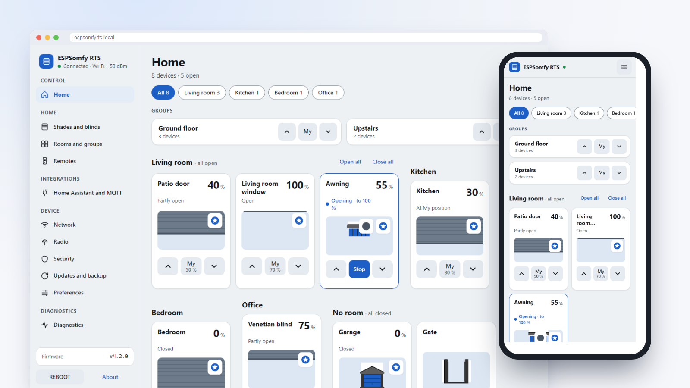

    

# ESPSomfy-RTS

An ESP32 and a CC1101 radio module that control your **Somfy RTS** shades, blinds, awnings, curtains, gates and garage doors, from a web page, Home Assistant or MQTT. Your remotes keep working: the board hears them and keeps every position up to date.

**[Documentation (wiki)](https://github.com/Pulpyyyy/ESPSomfy-RTS/wiki)** · **[Install from the browser](https://pulpyyyy.github.io/ESPSomfy-RTS/)** · **[Releases](https://github.com/Pulpyyyy/ESPSomfy-RTS/releases)** · **[Version française](README_fr.md)** · [Report an issue](https://github.com/Pulpyyyy/ESPSomfy-RTS/issues)

## Features

* **Devices**: up to 30 shades, blinds, awnings, curtains, garage doors, gates and dry contacts, with tilt support, sorted in up to 14 rooms and driven together by up to 14 groups (one radio command for the whole group).
* **Radio**: RTS, RTW and RTV on 433.42 MHz (or 433.92 MHz, one frequency per transceiver), 56 and 80 bits. Motors without radio can be driven through relay modules.
* **Your remotes stay in charge**: link up to 7 remotes or sensors per device, and positions follow what they do. A repeater mode helps a motor that hears a remote badly.
* **Accurate positions**: computed from travel times, with a slat lift time and a winding correction, and a guided calibration that measures them with your own remote.
* **Home Assistant**: through the [ESPSomfy-RTS Enhanced](https://github.com/Pulpyyyy/ESPSomfy-RTS-enhanced) integration (found automatically), or through MQTT with Home Assistant discovery. An HTTP API and a WebSocket are available for everything else.
* **Network**: Wi-Fi with roaming, or wired Ethernet (WT32-ETH01, Olimex, LilyGO, wESP32 and others), and a fallback access point.
* **Security**: PIN code or password, for the whole interface or for the configuration only.
* **Safe updates**: from GitHub in one click, or by file. Images are checked against the real partition size, and a firmware that fails to start rolls back on its own.
* **Backups**: full backup and restore, including rolling codes. Backups from the original project and the 2.x forks are accepted, so nothing needs pairing again.
* **RF diagnostics**: noise floor, signal of every remote heard, drift alerts, and a recommended number of command repeats for each device.
* **Interface**: works the same on phone, tablet and computer, light and dark themes, any accent colour, in English, French, German and Spanish.

## Getting started

1. **Hardware**: an ESP32 board (4 MB of flash at least) and a CC1101 433 MHz module. The radio pins are chosen in the interface, with presets for common boards. Wiring guides: see [Getting started](https://github.com/Pulpyyyy/ESPSomfy-RTS/wiki/Getting-started).
2. **Flash it once over USB**, from the [flash page](https://pulpyyyy.github.io/ESPSomfy-RTS/) (Chrome or Edge), or with esptool and the `SomfyController.onboard.<board>.bin.zip` image of the [latest release](https://github.com/Pulpyyyy/ESPSomfy-RTS/releases).
3. **Connect it**: join the `ESPSomfyRTS` Wi-Fi network (password `espsomfy`), open `http://192.168.4.1` and choose your Wi-Fi network.
4. **Set it up**: security, radio, then your shades. Every later update goes over the network.

### Coming from rstrouse/ESPSomfy-RTS or a 2.x fork

Follow **[MIGRATION.md](MIGRATION.md)**: back up, flash once over USB (the partition layout changed in v3.0.0), restore. Shades, rooms, groups and rolling codes are carried over, nothing needs pairing again. A device that was moved to v3.x or later over the air shows **Manual action required** on its update page: the same guide applies.

## Home Assistant

* **[ESPSomfy-RTS Enhanced](https://github.com/Pulpyyyy/ESPSomfy-RTS-enhanced)** (recommended): made for this firmware. The board announces itself over SSDP as `urn:schemas-pulpyyyy-org:device:Somfy:1` and is discovered automatically; the integration logs in with your PIN or password.
* **MQTT**: turn on *Publish Discovery* in **Integrations › Home Assistant and MQTT**; shades appear through Home Assistant's MQTT discovery.
* The **official ESPSomfy-RTS-HA** integration still works with the same API, but does not recognise this firmware's announcement: add the board by its IP address.

## Documentation

The **[wiki](https://github.com/Pulpyyyy/ESPSomfy-RTS/wiki)** describes the current interface, page by page, in English and French:

* [Getting started](https://github.com/Pulpyyyy/ESPSomfy-RTS/wiki/Getting-started): hardware, flashing, first start.
* [Daily control](https://github.com/Pulpyyyy/ESPSomfy-RTS/wiki/Daily-control): the Home page and the position panel.
* [Shades](https://github.com/Pulpyyyy/ESPSomfy-RTS/wiki/Shades): adding, pairing, calibrating, linking remotes.
* [Rooms, groups and remotes](https://github.com/Pulpyyyy/ESPSomfy-RTS/wiki/Rooms-groups-remotes).
* [Integrations](https://github.com/Pulpyyyy/ESPSomfy-RTS/wiki/Integrations): Home Assistant, MQTT topics, HTTP API, WebSocket.
* [Device settings](https://github.com/Pulpyyyy/ESPSomfy-RTS/wiki/Device-settings): network, radio, security, updates and backup, preferences.
* [Diagnostics and troubleshooting](https://github.com/Pulpyyyy/ESPSomfy-RTS/wiki/Diagnostics-and-troubleshooting).

Hardware building is documented on the [original project's wiki](https://github.com/rstrouse/ESPSomfy-RTS/wiki) ([Simple ESPSomfy-RTS device](https://github.com/rstrouse/ESPSomfy-RTS/wiki/Simple-ESPSomfy-RTS-device), [Mini ESP32-S3 build](https://github.com/rstrouse/ESPSomfy-RTS/wiki/Mini-ESP32s3-Device-Build), [Controlling motors with GPIO](https://github.com/rstrouse/ESPSomfy-RTS/wiki/Controlling-Motors-with-GPIO)). Its software, installation and update pages describe the original firmware: use this project's wiki for those.

## Fallback access point

When the board cannot join a network (first start, wrong password, network down), it opens its own Wi-Fi network so you can set it up again:

* **SSID**: the device hostname (`ESPSomfyRTS` by default).
* **Password (WPA2)**: `espsomfy`.
* **Address**: `http://192.168.4.1`.

The password is fixed and public on purpose: it only guards joining that network. The interface itself stays protected by your PIN or password if you set one.

## Reset by power cycles

If the interface can no longer be reached, plug the board in and unplug it within 5 seconds, several times in a row:

* **exactly 3 times**: the Wi-Fi settings are erased and security is turned off; devices and other settings are kept;
* **6 times or more**: full factory reset.

Details in [Diagnostics and troubleshooting](https://github.com/Pulpyyyy/ESPSomfy-RTS/wiki/Diagnostics-and-troubleshooting#reset-by-power-cycles).

## Credits

ESPSomfy-RTS was created by [rstrouse](https://github.com/rstrouse). This project started from [xkain's fork](https://github.com/xkain/ESPSomfy-RTS) of it.

Thanks to [y-streibel-uiris](https://github.com/y-streibel-uiris) for the HTTPS WebSocket support.
