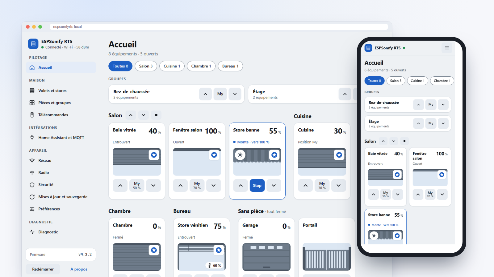

    

# ESPSomfy-RTS

Une carte ESP32 reliée à un module radio CC1101 pilote vos volets, stores, bannes, rideaux, portails et portes de garage **Somfy RTS**, depuis une page web, Home Assistant ou MQTT. Vos télécommandes continuent de fonctionner : la carte les entend et tient chaque position à jour.

**[Documentation (wiki)](https://github.com/Pulpyyyy/ESPSomfy-RTS/wiki)** · **[Installer depuis le navigateur](https://pulpyyyy.github.io/ESPSomfy-RTS/)** · **[Versions](https://github.com/Pulpyyyy/ESPSomfy-RTS/releases)** · **[English version](README.md)** · [Signaler un problème](https://github.com/Pulpyyyy/ESPSomfy-RTS/issues)

## Fonctionnalités

* **Équipements** : jusqu'à 30 volets, stores, bannes, rideaux, portes de garage, portails et contacts secs, avec gestion des lames orientables, rangés dans 14 pièces au plus et pilotés ensemble par 14 groupes au plus (une seule commande radio pour tout le groupe).
* **Radio** : RTS, RTW et RTV en 433,42 MHz (ou 433,92 MHz, une fréquence par émetteur-récepteur), 56 et 80 bits. Les moteurs sans radio se pilotent par des modules relais.
* **Vos télécommandes gardent la main** : liez jusqu'à 7 télécommandes ou capteurs par équipement, et les positions suivent ce qu'ils font. Un mode répéteur aide un moteur qui entend mal une télécommande.
* **Positions justes** : calculées à partir des temps de course, avec un temps de décollage des lames et une correction d'enroulement, et une calibration guidée qui les mesure avec votre propre télécommande.
* **Home Assistant** : par l'intégration [ESPSomfy-RTS Companion](https://github.com/Pulpyyyy/ESPSomfy-RTS-companion) (découverte automatique), ou par MQTT avec la découverte Home Assistant. Une API HTTP et un WebSocket sont disponibles pour tout le reste.
* **Réseau** : Wi-Fi avec itinérance, ou Ethernet filaire (WT32-ETH01, Olimex, LilyGO, wESP32 et d'autres), et un point d'accès de secours.
* **Sécurité** : code PIN ou mot de passe, pour toute l'interface ou pour la configuration seulement.
* **Mises à jour sûres** : depuis GitHub en un clic, ou par fichier. Les images sont vérifiées contre la taille réelle des partitions, et un firmware qui ne démarre pas revient tout seul à la version précédente.
* **Sauvegardes** : sauvegarde et restauration complètes, codes tournants compris. Les sauvegardes du projet d'origine et des forks 2.x sont acceptées : rien à réappairer.
* **Diagnostic radio** : plancher de bruit, signal de chaque télécommande entendue, alertes de dérive, et un nombre de répétitions conseillé pour chaque équipement.
* **Interface** : la même sur téléphone, tablette et ordinateur, thèmes clair et sombre, n'importe quelle couleur d'accent, en français, anglais, allemand et espagnol.

## Fiabilité et sécurité

* **Chaque ordre passe** : les commandes sont mises en file et la carte répond aussitôt, pendant qu'une tâche radio dédiée, sur son propre cœur de processeur, les émet. Les arrêts passent en premier. Chaque ordre part en un seul train continu, comme un appui sur une télécommande : les volets ne ratent plus d'ordres quand plusieurs sont commandés ensemble. La carte n'émet pas pendant qu'une télécommande est reçue (ni dans les 150 ms qui suivent) ni pendant qu'un autre émetteur occupe la fréquence, attend au plus 3 s (0,5 s pour un arrêt) et garde son temps d'émission sous les 10 % autorisés sur la bande 433 MHz. Chaque équipement répète ses ordres au moins deux fois.
* **Un affichage fluide** : un volet en mouvement envoie sa position toutes les 250 ms, et tout de suite quand il change de sens, à l'interface web, à Home Assistant et à MQTT. Le serveur web est asynchrone : pages, appels d'API et commandes ne s'attendent pas. Avec ESPSomfy-RTS Companion, plusieurs volets qui bougent ensemble s'affichent sans saccade dans Home Assistant.
* **Économe en mémoire** : l'interface est servie compressée et gardée une semaine par le navigateur, les réponses sont construites dans des tampons fixes, le client TLS de MQTT (environ 40 Ko) n'existe que si `mqtts://` est utilisé, et les vérifications GitHub ne chargent que les certificats racines nécessaires.
* **Home Assistant et la carte, sécurisés** : avec un code PIN ou un mot de passe, les appels d'API exigent la clé renvoyée à la connexion, que l'intégration obtient avec votre code (avec *Ne protéger que la configuration*, seules les modifications de configuration l'exigent). Le flux des trames radio reçues, qui suffirait à cloner une télécommande, l'exige aussi. Les requêtes venant d'autres sites web sont refusées, les codes faux sont ralentis après 5 essais (jusqu'à 5 minutes entre deux essais) et la carte ne renvoie jamais un mot de passe. Un fichier envoyé pour une mise à jour ou une restauration est contrôlé avant toute écriture. Le lien entre Home Assistant et la carte reste en HTTP non chiffré sur votre réseau local.

## Mise en route

1. **Matériel** : une carte ESP32 (4 Mo de flash au moins) et un module CC1101 433 MHz. Les broches radio se choisissent dans l'interface, avec des préréglages pour les cartes courantes. Guides de câblage : voir [Mise en route](https://github.com/Pulpyyyy/ESPSomfy-RTS/wiki/fr-Mise-en-route).
2. **Flashez-la une fois par USB**, depuis la [page de flash](https://pulpyyyy.github.io/ESPSomfy-RTS/) (Chrome ou Edge), ou avec esptool et l'image `SomfyController.onboard.<carte>.bin.zip` de la [dernière version](https://github.com/Pulpyyyy/ESPSomfy-RTS/releases).
3. **Connectez-la** : rejoignez le réseau Wi-Fi `ESPSomfyRTS` (mot de passe `espsomfy`), ouvrez `http://192.168.4.1` et choisissez votre réseau Wi-Fi.
4. **Configurez-la** : sécurité, radio, puis vos volets. Toutes les mises à jour suivantes passent par le réseau.

### Vous venez de rstrouse/ESPSomfy-RTS ou d'un fork 2.x

Suivez **[MIGRATION_fr.md](MIGRATION_fr.md)** : sauvegarde, un flash USB (la table de partitions a changé en v3.0.0), restauration. Volets, pièces, groupes et codes tournants sont repris, rien à réappairer. Une carte passée en v3.x ou plus par OTA affiche **Action manuelle requise** sur sa page de mise à jour : le même guide s'applique.

## Home Assistant

* **[ESPSomfy-RTS Companion](https://github.com/Pulpyyyy/ESPSomfy-RTS-companion)** (recommandée) : faite pour ce firmware. Home Assistant trouve la carte tout seul, par son annonce UPnP (SSDP) ou mDNS ; l'intégration se connecte avec votre PIN ou mot de passe.
* **MQTT** : activez *Publier découverte* dans **Intégrations › Home Assistant et MQTT** ; les volets apparaissent par la découverte MQTT de Home Assistant.
* L'intégration **officielle ESPSomfy-RTS-HA** trouve aussi la carte et fonctionne avec la même API ; Companion est celle faite pour ce firmware.
* La découverte automatique ne traverse pas les routeurs : si Home Assistant est sur un autre segment de réseau (VLAN), ajoutez la carte par son adresse IP.

## Documentation

Le **[wiki](https://github.com/Pulpyyyy/ESPSomfy-RTS/wiki)** décrit l'interface actuelle, page par page, en français et en anglais :

* [Mise en route](https://github.com/Pulpyyyy/ESPSomfy-RTS/wiki/fr-Mise-en-route) : matériel, flash, premier démarrage.
* [Pilotage au quotidien](https://github.com/Pulpyyyy/ESPSomfy-RTS/wiki/fr-Pilotage) : la page d'accueil et le panneau de position.
* [Volets et stores](https://github.com/Pulpyyyy/ESPSomfy-RTS/wiki/fr-Volets) : ajout, appairage, calibration, télécommandes liées.
* [Pièces, groupes et télécommandes](https://github.com/Pulpyyyy/ESPSomfy-RTS/wiki/fr-Pieces-groupes-telecommandes).
* [Intégrations](https://github.com/Pulpyyyy/ESPSomfy-RTS/wiki/fr-Integrations) : Home Assistant, topics MQTT, API HTTP, WebSocket.
* [Réglages de l'appareil](https://github.com/Pulpyyyy/ESPSomfy-RTS/wiki/fr-Reglages-appareil) : réseau, radio, sécurité, mises à jour et sauvegarde, préférences.
* [Diagnostic et dépannage](https://github.com/Pulpyyyy/ESPSomfy-RTS/wiki/fr-Diagnostic-depannage).

Le montage matériel est documenté sur le [wiki du projet d'origine](https://github.com/rstrouse/ESPSomfy-RTS/wiki), en anglais ([Simple ESPSomfy-RTS device](https://github.com/rstrouse/ESPSomfy-RTS/wiki/Simple-ESPSomfy-RTS-device), [Mini ESP32-S3 build](https://github.com/rstrouse/ESPSomfy-RTS/wiki/Mini-ESP32s3-Device-Build), [Controlling motors with GPIO](https://github.com/rstrouse/ESPSomfy-RTS/wiki/Controlling-Motors-with-GPIO)). Ses pages sur le logiciel, l'installation et les mises à jour décrivent le firmware d'origine : pour celles-ci, utilisez le wiki de ce projet.

## Point d'accès de secours

Quand la carte ne parvient pas à rejoindre un réseau (premier démarrage, mauvais mot de passe, réseau indisponible), elle ouvre son propre réseau Wi-Fi pour permettre de la reconfigurer :

* **SSID** : le nom d'hôte de la carte (`ESPSomfyRTS` par défaut).
* **Mot de passe (WPA2)** : `espsomfy`.
* **Adresse** : `http://192.168.4.1`.

Le mot de passe est fixe et public, volontairement : il ne protège que l'accès à ce réseau. L'interface elle-même reste protégée par votre PIN ou mot de passe si vous en avez défini un.

## Réinitialisation par coupures de courant

Si l'interface n'est plus joignable, branchez la carte puis débranchez-la dans les 5 secondes, plusieurs fois de suite :

* **exactement 3 fois** : les réglages Wi-Fi sont effacés et la sécurité désactivée ; les équipements et les autres réglages sont conservés ;
* **6 fois ou plus** : retour complet aux réglages d'usine.

Détails dans [Diagnostic et dépannage](https://github.com/Pulpyyyy/ESPSomfy-RTS/wiki/fr-Diagnostic-depannage#réinitialisation-par-coupures-de-courant).

## Crédits

ESPSomfy-RTS a été créé par [rstrouse](https://github.com/rstrouse). Ce projet est parti du [fork de xkain](https://github.com/xkain/ESPSomfy-RTS).

Merci à [y-streibel-uiris](https://github.com/y-streibel-uiris) pour la prise en charge du WebSocket HTTPS.
